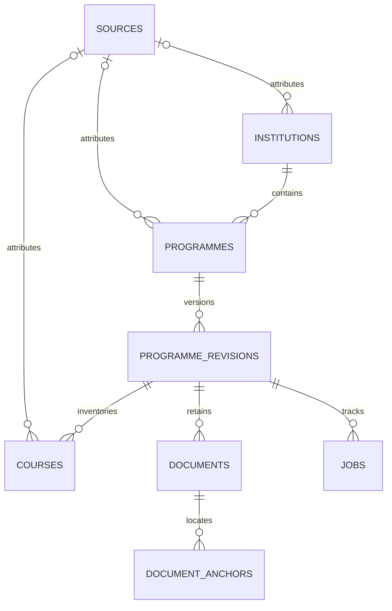

# Phase 1 migration audit — 2026-10-24

The existing repository at `453b79e` contained a working Phase 1 foundation. The revised starter was specifications and fixtures, not a replacement application. This revision adapts that checkout and retains its history. Phase 2 is not implemented.

## Requirement comparison

| Requirement | Existing implementation | Adaptation / remaining boundary |
|---|---|---|
| Multiple universities and programmes | Institution/programme FKs, unrestricted names and programme counts | Retained; nested institution programme listing/creation added |
| All courses in a programme | Versioned, paginated course inventory including electives and unknown syllabi | Retained; manual course create/read added; no discipline or course-count cap |
| Year/semester and optional syllabus | Nullable course year/semester/code, UNKNOWN type, explicit syllabus availability | Retained; no title-derived learning content |
| Provenance and quality | Documents, exact anchors, hashes and synthetic flags; no URL-backed source table | Added sources, catalogue source/locator links, verification flag and computed quality |
| Programme metadata | Name/code/academic year and active revision | Added optional level, discipline and canonical URL; institution website URL |
| PostgreSQL/FastAPI/validation | SQLAlchemy 2, Alembic, Pydantic v2, synchronous sessions, typed errors | Retained; additive 0002; dependency pins/lock and Python 3.12+ target |
| Offline mode | Idempotent 12-course synthetic JSON importer | Preserved format, payload, IDs, anchors and hashes; revised fixtures remain future acceptance inputs |
| Health/error compatibility | Liveness/readiness, request IDs, `{error:{code,message,details}}` | Retained; `/health` liveness alias added |
| Programme-wide analysis | Revision boundary suitable for future reproducible runs | No engine/result/action implementation in Phase 1 |
| Revised product/docs | SWE pilot, upload-first onboarding, older roadmap | All discoverable XMUM undergraduate programmes and optional syllabi; legacy filenames redirect |

## Preserved components

The app factory/lifespan, settings, engine/session lifecycle, original global programme routes and response fields, exception handling, logging/request IDs, Compose configuration, seven original tables, initial migration and fixture importer remain usable. No existing course/programme IDs were regenerated. No real curriculum data, student records, API keys or invented XMUM findings were added.

The importer and sample payload are unchanged. API course additions are refused for checksum-protected fixture revisions to keep identical re-imports idempotent. Ordinary course POST creates a record; import/upsert deduplication, source identity and normalisation belong to Phase 2.

## Database architecture and migration

There are eight application tables. A programme selects an active revision; the composite ownership FK prevents choosing another programme's revision. Courses retain document-anchor pointers alongside new registry provenance. Revisions remain the snapshot boundary.

`0002_catalogue_sources` follows unchanged `0001_foundation`. It adds the registry, nullable metadata, indexes/FKs and `courses.is_verified=false`. Existing data, timestamps, relationships, JSON and anchors are preserved. Source-less records remain incomplete or synthetic; no URLs, dates or verification are invented.

Back up the intended database, inspect `python -m alembic current`, then run `python -m alembic upgrade head`. No reset, stamp, table replacement or production migration was performed here. Validation used disposable local PostgreSQL data.

Downgrade requires a live database, locks affected tables and refuses if source rows or added metadata would be lost. A refusal requires a deliberate preservation/rollback plan, not deletion. Clean rollback/re-upgrade and populated-0001 preservation were tested.

## Provenance and phase limits

Seven evidence classes are explicit. Nonsynthetic sources require HTTP(S) origin URLs; missing dates remain null. Registration fetches no URL and authenticates no publisher. A caller's catalogue verification assertion requires a nonsynthetic university-fact source and locator; benchmarks and synthetic lineage cannot establish it through the API. It never verifies taught topics, learning outcomes, syllabus content, completeness or academic relevance.

Create/read scope matches Phase 1's endpoint contract. Generic PATCH/DELETE, authentication, provenance review, source retirement and verified discovery are pending their relevant phases. Jobs provide storage, not an executing worker.

## Verification and completion

[STATUS.md](../STATUS.md) records exact results: 144 tests passed, including three live PostgreSQL migration cases; Ruff and dependency checks passed. Real localhost Uvicorn/PostgreSQL checks created three synthetic disciplines with six courses and imported the original 12-course fixture twice without duplication. One upstream Starlette/httpx deprecation warning remains; no test failure remains.

No Phase 1 acceptance blocker remains. Python 3.13/Windows and PostgreSQL 16.15 were tested locally. Python 3.12/PostgreSQL 16 also passed in [GitHub Actions run 39998532797](https://github.com/RikoHalim/shift-os/actions/runs/39998532797) for implementation commit `866df6c`; installation, lint, formatting and all test steps succeeded. This result was checked independently of the original commit's CI run.

## Next step and external gap

Next recommendation: [Phase 2 curriculum discovery](../prompts/02_CURRICULUM_DISCOVERY.md) only, with bounded official-source access, provenance, manual fallback, idempotency and truthful coverage. Syllabi remain optional. No Phase 2 code was built.

Preliminary proof/proposal priorities, six original final-product requirements and post-hackathon improvements are separated in [the roadmap](12_MVP_ROADMAP.md). Institutional framing and CV exemption are user-reported approvals. Individual intake, role matching and personalised-pathway waivers remain **UNCONFIRMED**; no written organiser evidence was supplied.
