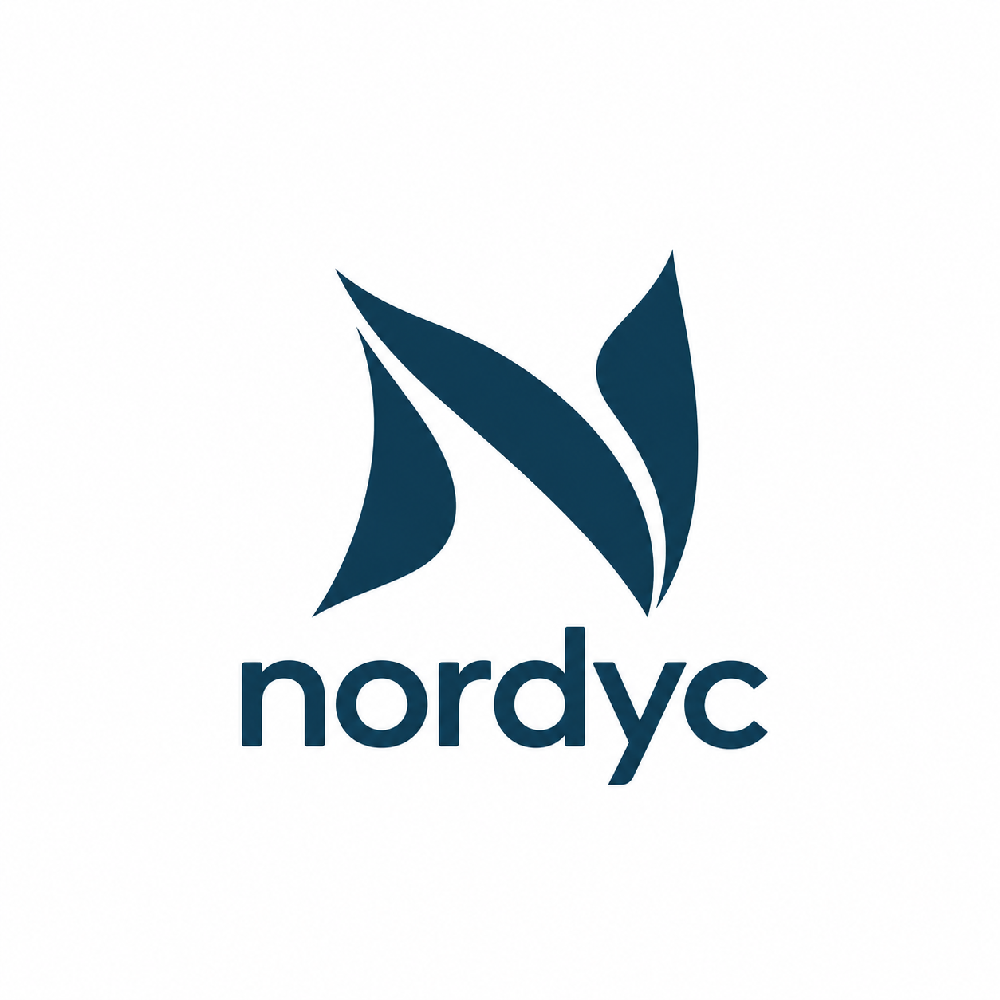
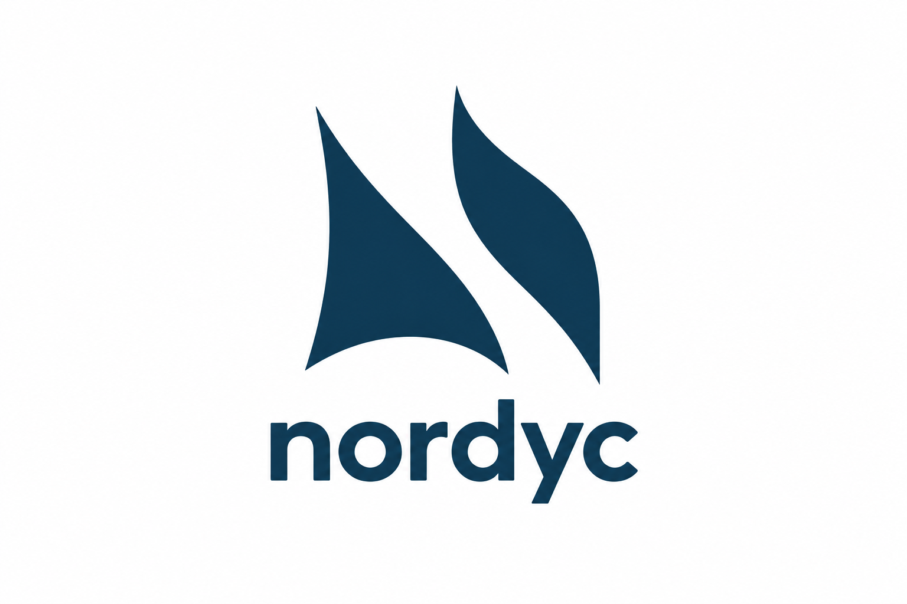
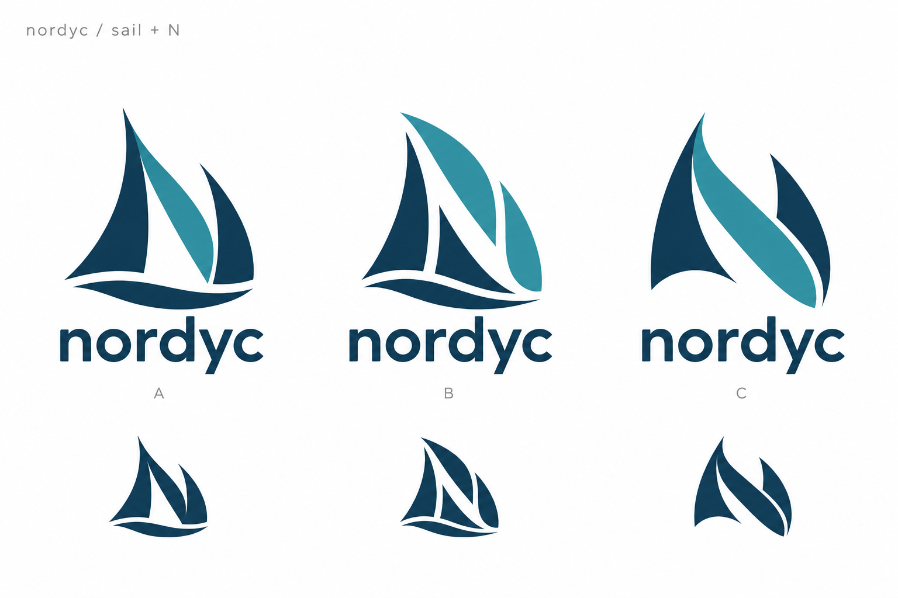
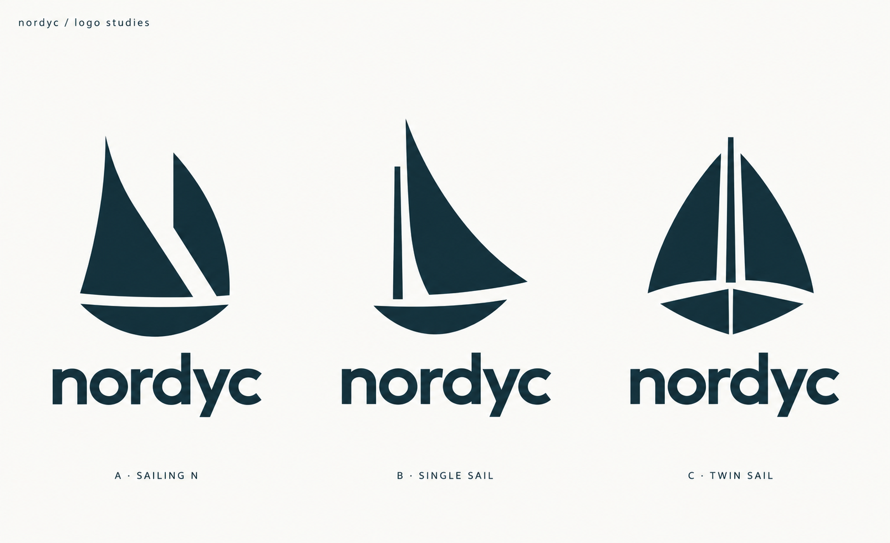
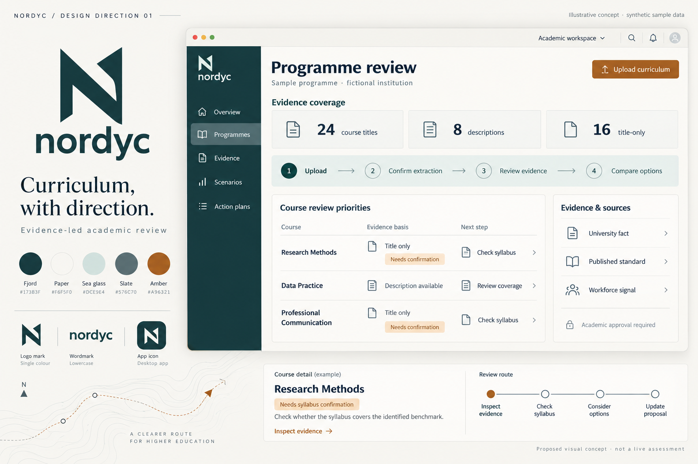
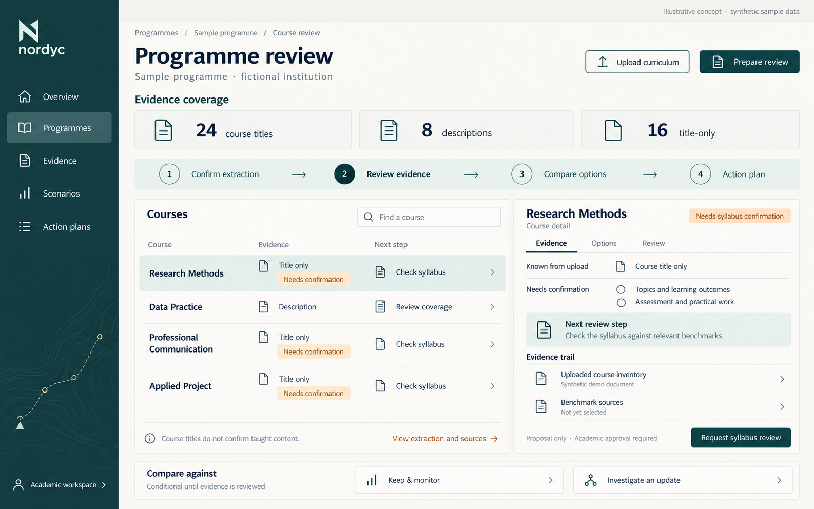

# nordyc — proposed visual concept

**Concept only · 24 October 2026 · synthetic demonstration content**

## Current focus: logo exploration

The latest request is to improve the design while retaining simplicity, curves and the N/sailing connection. The new candidate emphasises a clearer N silhouette through three curved sail-like strokes and a lowercase wordmark. It is not a selected final logo.

The [generation prompt and output notes](assets/nordyc/logo-flowing-n-prompt-v5.md) record the built-in image-generation process and remaining vector refinement. Suggested next prompt: “Refine the flowing N logo's proportions and spacing.”

## Earlier two-shape iteration

The latest user refinements are **“simpler”**, then **“more curve”**. The current candidate is a two-shape, single-colour sail/N symbol with fuller outer curves and a curved diagonal seam. The hull, waves and layered colour facets have been removed. This is a refinement candidate, not a selected final logo.

The [simple predecessor](assets/nordyc/nordyc-simple-n-v3.png) and [complete generation/edit prompts](assets/nordyc/logo-simple-curved-prompts.md) preserve the iteration. Both were generated with the built-in image-generation tool. Suggested next prompt: “Refine the curved two-shape Nordyc N while keeping it simple.”

## Earlier reference-led studies

The latest brief uses five user-provided sailing references: curved sails, flowing shapes and open negative-space seams, with a recognisable **N integrated into the mark**. These new studies replace the earlier generic sailboat direction as the current exploration. No mark has been selected.

- **A:** curved sail strokes form an N above a shallow hull.
- **B:** an open negative-space N divides the sail panels.
- **C:** a folded sail/ribbon forms a more abstract N with no separate hull.

The navy/teal shapes and smaller one-colour silhouettes support comparison. The [complete prompt and reference inventory](assets/nordyc/logo-sail-n-prompt-v2.md) record the built-in image-generation process. These are raster concepts; final vector construction and small-size testing remain after selection.

Suggested next prompt: “Refine reference-led Nordyc logo option A/B/C. Keep the curved sail character and readable N, and show a standalone symbol plus wordmark.”

## Earlier logo study

The user found the initial app direction too generic, then rejected a more literal ship-and-island chartroom as too game-like. The latest instruction is **logo first**. The app concepts below are archived explorations, not an approved visual direction. No logo is selected yet.

- **A · Sailing N:** two sails suggest the initial N above a compact hull.
- **B · Single Sail:** an asymmetric sail and hull, with a simpler silhouette.
- **C · Twin Sail:** a balanced front-facing vessel with two sails.

The same wordmark and ink colour are used to compare the symbols. The built-in image-generation tool produced this sheet; its [complete generation prompt](assets/nordyc/logo-studies-prompt.md) is retained. These are raster design studies, with small-size reproduction and final geometry still to be refined after the user chooses a direction.

Suggested next prompt: “Refine Nordyc logo option A/B/C. Keep the sailing connection, simplify the silhouette, and show icon-only and wordmark versions.”

## Earlier app exploration — not approved

Nordyc is the proposed public-facing identity for the curriculum review product currently documented as SHIFT//OS. This concept helps Malaysian university academic affairs teams, programme leads and career services review curricula with traceable evidence. Authorised humans make academic decisions.

**Headline:** Curriculum, with direction.  
**Functional description:** Evidence-led academic review

## Brand direction

Use the quiet precision of Nordic design and the navigational idea of a ship finding its course. Express direction, clarity and considered progress through alignment, whitespace and a small sail motif. The interface should feel credible in an academic committee meeting.

- **Wordmark:** lowercase `nordyc`, with generous but restrained spacing and a clear, rounded humanist sans-serif. Keep the spelling easy to read.
- **Monogram:** a simple geometric N whose diagonal suggests a sail and whose upright suggests north. Use one solid colour, with enough negative space to remain legible at small sizes. The symbol must also work without the wordmark.
- **Maritime detail:** a thin route line, a small north marker or a faint chart grid can appear on a brand board or entry screen. Use sparingly; working screens prioritise evidence and readable tables.
- **Restraint:** avoid Viking helmets, shields, runes, elaborate longships, illustrated ocean backgrounds and nautical labels for ordinary controls. The theme belongs in the identity, not in every component.

## Colour and typography

| Token | Colour | Proposed role |
|---|---|---|
| Fjord | `#173B3F` | Wordmark, primary text, primary buttons and active navigation |
| Paper | `#F6F5F0` | Main canvas and quiet background |
| Sea glass | `#DCE9E4` | Selected surfaces, soft panels and supporting brand colour |
| Slate | `#576C70` | Supporting text and secondary information |
| Amber | `#A96321` | Review attention and caution, paired with explicit wording |

Use an accessible humanist sans-serif such as Source Sans 3 or a suitable system fallback. Start body and table text at 16 px; use clear hierarchy, comfortable line height and readable sentence case. Avoid thin weights, small pale labels and decorative display type in analysis screens.

Check contrast for actual foreground/background pairs during any later UI implementation. Sea glass is a surface colour, not a text colour. Every status needs a label and an additional cue such as an icon or border: **Needs review**, **Insufficient evidence**, **Pending syllabus confirmation** and **Approved by reviewer** must remain distinguishable without colour. Reserve approval wording for an actual recorded human decision. Provide visible focus states, labelled controls and keyboard access in a later implementation.

## Application structure

Primary navigation: **Overview / Programmes / Evidence / Scenarios / Action plans**.

| Area | Essential proposed content |
|---|---|
| Overview | Clear next step, recent review work and evidence limitations; no invented performance metrics |
| Programmes | Minimal institution/programme selection, upload entry, extraction review, evidence coverage and every available course |
| Evidence | Source classes, original links, dates, locators, coverage and unresolved disagreements |
| Scenarios | Named assumptions and sensitivity of review priorities; no replacement-probability presentation |
| Action plans | Proposed actions, alternatives including no change, conditions, owners and human review status |

Use a stable left navigation, a modest top bar and a wide, calm working canvas. Prefer readable lists and tables over decorative charts. A selected programme and review version should remain visible while staff inspect courses and evidence.

## Proposed journey and screen components

1. **Upload-first entry.** Select a programme and upload an available curriculum, brochure or syllabus. Explain that a brochure/title inventory is enough to start a preliminary review. Offer public discovery as a secondary option. Detailed syllabi, budget and planning period are not mandatory entry fields.
2. **Review extraction.** Show extracted courses and explicit year/elective information beside their origin. Let reviewers resolve ambiguous candidates and missing fields before analysis. Do not imply an unreviewed extraction is verified.
3. **Show evidence coverage first.** Distinguish verified catalogue information, description-only records, title-only records and missing syllabi. Show source dates and unknowns. These describe available evidence, not curriculum quality.
4. **Review each course.** Present a course table with evidence basis, review status and next step. A detail panel brings together known course information, relevant benchmarks, dated workforce and AI signals, precise citations, disagreements and uncertainty. Keep **Pending syllabus confirmation** beside title-only review prompts.
5. **Compare responses.** Present a conditional evidence-supported proposal and legitimate alternatives, including **No change / monitor pending review** where defensible. Compare evidence strength, learning-outcome relevance, academic disruption, feasibility assumptions and missing verification. Budget and planning period may be optional here.
6. **Prepare a human-reviewed action plan.** Separate investigation candidates from academically approved actions. Show proposed responsibility, conditions, supporting sources and review status. Approval is an explicit human step; an export is a proposal for review until approval is recorded.

Suggested controls use plain language: **Upload curriculum**, **Review extracted courses**, **View evidence**, **Compare options** and **Prepare action plan**. Maritime metaphors should not obscure these tasks.

## Evidence and mockup content rules

All concept screens must display **Illustrative concept · synthetic sample data** prominently. Use a fictional institution and sample programme, with no association to a real university. The visible disclaimer applies to every illustrative course row and count; detail panels retain the synthetic document label. Any exported or standalone excerpt must retain its own synthetic label.

- Include no actual university data, invented institutional course facts, assessment results, scores, job counts, efficacy claims, placement rates or partner logos.
- A title alone supports a prompt to investigate coverage, not a definitive obsolete/replacement ruling. Use **Review coverage of…** or **Insufficient evidence** as appropriate.
- Preserve the distinction between university facts, published standards, occupation requirements, dated workforce signals, dated AI capability, inference and synthetic demonstration content. Benchmarks do not prove what a university teaches.
- Keep workforce demand separate from AI exposure. Neither implies a course should be removed. Do not use a single readiness score or decorative SDG badge as a substitute for evidence and rationale.
- In a later working screen, recommendations need admissible evidence pointers or an explicit insufficient-evidence result. Links, source dates and uncertainty remain part of the main experience.

## Concept assets

These images are visual explorations; this specification governs intended wording and evidence behaviour where image-generated text is approximate.

### Brand board

### Programme review screen

The image generation instructions are retained in [generation prompts](assets/nordyc/generation-prompts.md).

## Scope boundary

This is a proposed visual identity and screen concept, not frontend/backend implementation or a completed product rebrand. Existing implementation remains at the documented **Phase 3** boundary. Course analysis, recommendations, scenario comparisons, approvals and the dashboard shown here describe intended future experiences, not newly delivered functions. No schema, API, database, model configuration or runtime behaviour is changed by this concept.

The [product requirements](01_PRODUCT_REQUIREMENTS.md), [academic action rules](07_ACADEMIC_ACTIONS.md), [current status](../STATUS.md) and [hackathon compliance gaps](09_HACKATHON_COMPLIANCE.md) remain authoritative. Reported acceptance of institutional framing and the CV-upload exemption does not establish a blanket waiver for personal matching/pathways, SDG linkage or multiple scenarios. Those unconfirmed gaps remain unchanged.

## Artifact checks

Saved image dimensions, PNG signatures, local document links and Markdown whitespace were checked for the design kit. This is an image/Markdown change; application tests and database migrations are not applicable. No development phase was started, and no commit or push was performed.
